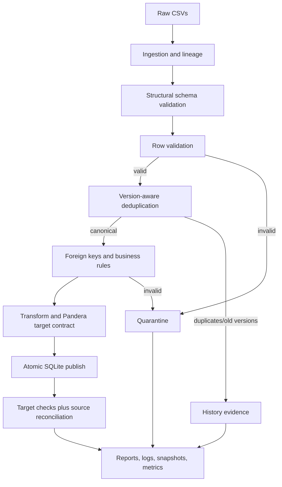
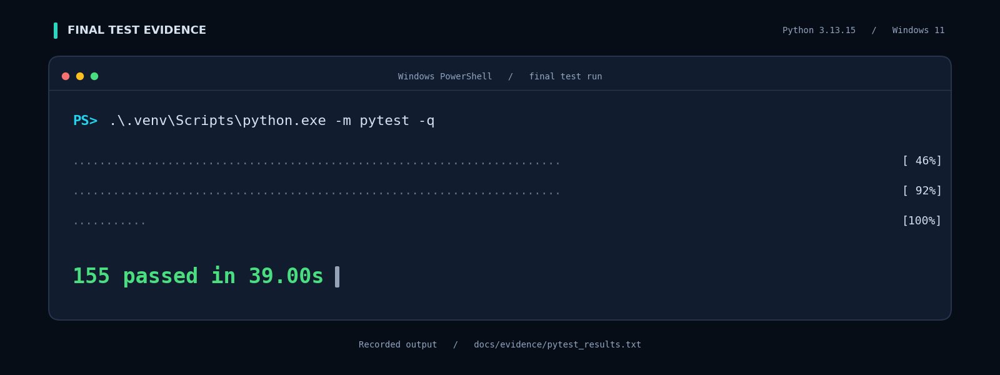

# E-commerce Order Analytics Pipeline

A local, end-to-end data engineering project that ingests synthetic e-commerce
orders, validates and quarantines bad records, resolves duplicate versions,
publishes atomically to SQLite, reconciles every source row, and emits
machine-readable operational evidence.

The project is deliberately small enough to run on a laptop but exercises the
engineering behaviours that matter in production: explicit contracts,
deterministic duplicate handling, atomic publishing, idempotent reruns,
transient-failure retries, late-arriving data, reconciliation, structured logs,
and reproducible tests.

---

## 1. Business problem

An e-commerce team receives daily CSV extracts for customers, products, orders,
order items, and payments from several operational systems. The extracts are not
trustworthy by default:

- rows contain missing required values, malformed timestamps, wrong types, and
  values outside business ranges;
- the same order or customer can appear more than once, sometimes as an exact
  duplicate and sometimes as an older version arriving after a newer one;
- child records can reference customers, orders, or products that were rejected;
- order totals and captured payments can disagree with line-item totals.

Publishing those rows directly would create duplicate revenue, broken foreign
keys, and dashboards that cannot be reconciled. The pipeline must make the
quality of each batch visible, preserve rejected records for investigation, and
never leave a partially published batch behind.

## 2. Objective

Build a reproducible pipeline that:

1. validates source structure and every row against explicit contracts;
2. classifies each source row as published, updated, unchanged, late-arriving,
   duplicate, or rejected;
3. quarantines invalid records with all failed rules and reasons;
4. publishes accepted rows in one transaction and rolls back on any failure;
5. proves source-to-target reconciliation and business aggregates;
6. makes identical reruns idempotent;
7. provides automated unit, integration, data-quality, and regression tests;
8. measures performance and demonstrates a measured optimization;
9. documents assumptions, trade-offs, and limitations honestly.

## 3. Selected use case and justification

**E-commerce order and payment analytics** is used because it has a compact but
realistic relational model, clear business rules, natural duplicate/version
semantics, and aggregates that can be independently reconciled:

- `customers 1 -> * orders`
- `orders 1 -> * order_items`
- `products 1 -> * order_items`
- `orders 1 -> * payments` (split payments are legitimate)

The domain makes it possible to test a broad set of data-quality failures
without inventing artificial rules: orphan orders, missing line items, quantity
bounds, order-total mismatches, payment tolerance, and late-arriving versions.
It is also a common evaluation scenario, so the design is easy to explain.

## 4. Features

- Typed source contracts and Pandera target contracts.
- Structural validation: required, unexpected, duplicate, and blank headers.
- Row validation with multiple simultaneous rejection reasons.
- UTF-8/BOM handling and malformed-CSV rejection.
- Deterministic version-aware deduplication on business key + `updated_at`.
- Exact duplicates removed, superseded versions archived, ambiguous conflicts
  quarantined.
- Foreign-key validation against parents accepted in the same batch plus
  referenced parent keys already committed by earlier runs (chunked lookups,
  incremental batches).
- E-commerce business rules: order has items, order-total equality, payment
  tolerance, split-payment overpayment detection, zero-total free orders, and
  late payments checked against committed order totals.
- Atomic SQLite publish with target checks and reconciliation verification inside
  the transaction.
- Exponential-backoff retries for transient errors only.
- Idempotent business rows, quarantine rows, history rows, and audit counts.
- Structured JSONL logs, run metrics, DQ reports, reconciliation reports, and
  optional DQ chart.
- Reproducible 79-row curated dataset and seeded 10k/100k-row generator.
- 156 automated tests spanning unit, integration, data-quality, and regression
  suites.
- Reproducible benchmark comparing vectorized and naive deduplication plus
  end-to-end small, 10k, and 100k runs.

## 5. Technology stack

| Layer | Choice | Why |
|---|---|---|
| Language | Python 3.11+ (reference: 3.13.15) | Readable, testable, strong data ecosystem. |
| Data processing | pandas 2.3.3 | Appropriate for a local 100k-row vertical slice; vectorized operations measure well. |
| Numeric support | NumPy 2.3.5 | Seeded generation and vectorized operations. |
| Validation | Pandera 0.35.0 | Declarative target contract in addition to explicit source rules. |
| Database | SQLite via SQLAlchemy 2.0.44 | Zero-install local persistence, transactions, foreign keys, easy inspection. |
| Testing | pytest 8.4.2, pytest-cov 7.0.0 | Standard, fixture-friendly, coverage evidence. |
| Synthetic data | Faker 37.12.0 | Realistic names/emails without private data. |
| Charting | matplotlib 3.10.7 | Optional DQ summary image. |
| Dates | python-dateutil 2.9.0.post0 | ISO-8601 parsing support. |

No paid service, cloud account, credential, or secret is required. Dependencies
are pinned in `requirements.txt`.

## 6. Architecture



The publish transaction is the critical boundary: all five entities, history,
quarantine upserts, and target checks either commit together or roll back
together. Parent-key checks include both the current batch and committed target
rows, so a later incremental batch can add orders/items for existing parents.
See `docs/architecture.md` for the full module map and failure path.

## 7. Project structure

```text
data_pipeline_testing/
|-- data/
|   |-- raw/                  # source CSVs only
|   |-- processed/            # accepted snapshots, latest CSVs, warehouse.db
|   |-- rejected/             # quarantine and duplicate evidence CSVs
|   |-- expected/             # tracked expected-answer contract, separate from input
|   `-- benchmark/            # generated small/10k/100k benchmark inputs/outputs
|-- docs/
|   |-- data_dictionary.md
|   |-- architecture.md
|   |-- design_decisions.md
|   |-- edge_case_matrix.md
|   |-- testing.md
|   |-- performance.md
|   `-- evidence/             # curated, sanitized submission evidence
|-- reports/                  # run/DQ/reconciliation/benchmark evidence
|-- scripts/
|   |-- generate_data.py
|   |-- run_pipeline.py
|   |-- verify_outputs.py
|   |-- final_db_checks.py
|   |-- benchmark.py
|   `-- export_evidence.py
|-- src/
|   |-- config.py
|   |-- generator.py
|   |-- ingestion.py
|   |-- schemas.py
|   |-- validation.py
|   |-- deduplication.py
|   |-- transformations.py
|   |-- publishing.py
|   |-- reconciliation.py
|   |-- reporting.py
|   |-- monitoring.py
|   `-- pipeline.py
|-- tests/
|   |-- unit/
|   |-- integration/
|   |-- data_quality/
|   `-- regression/
|-- requirements.txt
|-- requirements-dev.txt      # pinned black/ruff tooling
|-- pyproject.toml            # black/ruff configuration
|-- pytest.ini
`-- README.md
```

The small sample under `data/raw/` is intentionally tracked so a fresh checkout
can reproduce the quickstart. Generated `data/processed/`, `data/rejected/`,
`data/benchmark/`, `reports/`, caches, and `.venv/` are excluded by `.gitignore`.
The expected-answer contract at `data/expected/small_expected.json` and the
sanitized `docs/evidence/` package are deliberately tracked. `.gitattributes`
normalizes tracked text files to LF.

## 8. Source and target schema overview

### Source grain

| Entity | Primary key | Foreign keys | Grain |
|---|---|---|---|
| `customers` | `customer_id` | - | One customer master row/version. |
| `products` | `product_id` | - | One product master row/version. |
| `orders` | `order_id` | `customer_id -> customers` | One order event/version. |
| `order_items` | `item_id` | `order_id -> orders`, `product_id -> products` | One order line/version. |
| `payments` | `payment_id` | `order_id -> orders` | One payment event/version; multiple payments per order allowed. |

Source CSVs are read as text so malformed values reach validation. Ingestion adds
`_source_file`, `_source_row_number`, `_run_id`, and `_ingested_at`.

### Target additions

- `orders.order_year_month` derived from `order_date`.
- `order_items.line_total = quantity * unit_price`, rounded to two decimals.
- `_pipeline_version` and `_record_hash` for traceability and deterministic
  duplicate comparison.
- `quarantine` and `record_history` audit tables.
- `pipeline_runs` run-metrics table keyed by `run_id`.

Column-level types, nullability, ranges, defaults, and rules are in
`docs/data_dictionary.md`.

## 9. Installation

### Windows PowerShell

```powershell
cd data_pipeline_testing
py -3 -m venv .venv
.\.venv\Scripts\Activate.ps1
.\.venv\Scripts\python.exe -m pip install --upgrade pip
.\.venv\Scripts\python.exe -m pip install -r requirements.txt
```

`py -3` selects the newest installed Python 3.11+ interpreter. Activation is
optional; the remaining commands use the explicit project interpreter so they
work even when the shell is not activated.

### macOS / Linux

```bash
cd data_pipeline_testing
python3 -m venv .venv
source .venv/bin/activate
.venv/bin/python -m pip install --upgrade pip
.venv/bin/python -m pip install -r requirements.txt
```

Python 3.11 or newer is required. The recorded environment used Python 3.13.15
on Windows 11. No environment variables are required; optional overrides are
`PIPELINE_DATA_DIR`, `PIPELINE_REPORTS_DIR`, `PIPELINE_DB_URL`, and
`PIPELINE_LOG_LEVEL`.

For development tooling:

```powershell
.\.venv\Scripts\python.exe -m pip install -r requirements-dev.txt
.\.venv\Scripts\python.exe -m ruff check .
.\.venv\Scripts\python.exe -m black --check .
```

**IDE-agnostic rule:** run scripts through the interpreter selected for the
project (`.venv\Scripts\python.exe` on Windows, `.venv/bin/python` on macOS/
Linux). Do not run a bare `scripts\generate_data.py` from an editor terminal:
Windows may open the `.py` file in an application instead of executing Python.
For example:

```powershell
.\.venv\Scripts\python.exe scripts\generate_data.py --preset small
```

The same rule applies to PyCharm, VS Code, Spyder, Jupyter, and any generic IDE:
select the project `.venv` interpreter, open the project root, and pass script
arguments after the Python executable.

## 10. Environment setup and clean reset

The database and generated run artifacts are local state. To start from zero:

```powershell
Remove-Item -Recurse -Force data\processed\* -ErrorAction SilentlyContinue
Remove-Item -Recurse -Force data\rejected\* -ErrorAction SilentlyContinue
Remove-Item -Recurse -Force data\benchmark\* -ErrorAction SilentlyContinue
Remove-Item -Recurse -Force reports\* -ErrorAction SilentlyContinue
```

This removes the warehouse, processed and rejected snapshots, benchmark
inputs/outputs, run reports, and logs. The tracked small sample under
`data/raw/` and the expected contract at `data/expected/small_expected.json`
are preserved; `generate_data.py --preset small` regenerates the sample
deterministically if it is deleted. Tracked evidence under `docs/evidence/` is
never part of this reset. The verification script uses global audit counts, so a
historical run can be rechecked after a rerun.

## 11. Generate the small sample

```powershell
.\.venv\Scripts\python.exe scripts\generate_data.py --preset small
```

This writes five source CSVs to `data/raw/` and the expected contract to
`data/expected/small_expected.json`. Expected labels are never read by the
pipeline. The generator is byte-deterministic for seed 42 and produces:

- 79 source rows;
- 32 expected target rows: 7 customers, 4 products, 6 orders, 8 items, 7 payments;
- 37 expected quarantined source rows;
- 10 expected duplicate/history rows;
- order total, line total, and captured payment aggregates of `200217.49`.

## 12. Run the small pipeline

First run:

```powershell
.\.venv\Scripts\python.exe scripts\run_pipeline.py --run-id demo-small-001
.\.venv\Scripts\python.exe scripts\verify_outputs.py --run-id demo-small-001 `
  --output reports/verification_demo-small-001.json
```

Idempotent rerun:

```powershell
.\.venv\Scripts\python.exe scripts\run_pipeline.py --run-id demo-small-002
.\.venv\Scripts\python.exe scripts\verify_outputs.py --run-id demo-small-002 `
  --output reports/verification_demo-small-002.json
.\.venv\Scripts\python.exe scripts\final_db_checks.py
```

Recorded result:

```text
demo-small-001: PARTIAL_SUCCESS
  input=79 valid=32 rejected=37 duplicate=10 published=32 unchanged=0
  duration=2.6329s

demo-small-002: PARTIAL_SUCCESS
  input=79 valid=32 rejected=37 duplicate=10 published=0 unchanged=32
  duration=1.9663s
```

Both runs pass 45/45 static verification checks. The first run inserted 32 target
rows; the rerun inserted zero and left the target and 37 quarantine / 10 history
audit rows unchanged (occurrence counts incremented to 2, which is intentional
audit evidence, not data duplication).

Sanitized JSON excerpt from `demo-small-001`:

```json
{
  "run_id": "demo-small-001",
  "status": "PARTIAL_SUCCESS",
  "input_rows": 79,
  "valid_rows": 32,
  "rejected_rows": 37,
  "duplicate_rows": 10,
  "published_rows": 32,
  "unchanged_rows": 0,
  "duration_seconds": 2.6329
}
```

A sanitized copy of the first run's JSON output is tracked at
`docs/evidence/sample_run_output.json`; the reconciliation, DQ, verification,
test, and benchmark evidence is indexed in `docs/evidence/README.md`. Generated
reports stay out of normal source control so the evidence package remains small
and free of machine-specific absolute paths. The local `reports/` tree is raw
runtime output and may contain the current machine's paths; use the sanitized
`docs/evidence/` copies for review or sharing.

## 13. Run the large pipeline

The easiest reproducible benchmark generates the curated 79-row small dataset,
a ~10k batch, and a ~100k batch, executes the full pipeline for each, validates
target counts against the generated expectation, and writes the benchmark
evidence:

```powershell
.\.venv\Scripts\python.exe scripts\benchmark.py --pipeline --repeat 3
```

Alternatively, generate and run a large batch manually:

```powershell
.\.venv\Scripts\python.exe scripts\generate_data.py --preset custom `
  --customers 1000 --products 500 --orders 24000 `
  --output-dir data/benchmark/raw `
  --expected-dir data/benchmark/expected
.\.venv\Scripts\python.exe scripts\run_pipeline.py `
  --data-dir data/benchmark `
  --db-path data/benchmark/warehouse.db `
  --reports-dir reports/benchmark `
  --run-id large-manual
```

The reference small run processed 79 rows in 1.995 seconds (39.6 rows/s); the
10k pipeline processed 10,202 rows in 2.816 seconds (3,623.4 rows/s); the 100k
pipeline processed 101,938 rows in 26.914 seconds (3,787.5 rows/s). All three
ended `PARTIAL_SUCCESS` and matched target counts exactly. For the 100k run:
1,000 customers, 500 products, 24,000 orders, 48,054 items, 24,000 payments.
See `docs/performance.md`.

## 14. Run the tests

```powershell
.\.venv\Scripts\python.exe -m pytest
```

With coverage and machine-readable coverage output:

```powershell
.\.venv\Scripts\python.exe -m pytest -q --cov=src --cov-report=term `
  --cov-report=json:reports/coverage.json
```

Recorded final result:

```text
156 passed in 46.53s
```

Duration varies by machine. The current recorded output is in
`docs/evidence/pytest_results.txt`.



*Earlier visual reference. The canonical current output is the text file
`docs/evidence/pytest_results.txt`; the image is supplementary.*

Suite composition: 70 unit tests, 21 integration tests, 60 data-quality tests,
and 5 regression tests. Coverage is 96% (2,164 statements, 94 missed); the
coverage-enabled run completed with no `ResourceWarning` messages and no
failures, errors, or skips. The pipeline disposes its engine on every exit path,
and the test harness tracks and disposes every SQLAlchemy engine created during
a test. Coverage and warnings are refreshed on each release run and recorded in
`docs/testing.md` and `docs/evidence/pytest_coverage_results.txt`. Test details
and the full requirement-to-test matrix are in `docs/testing.md` and
`docs/edge_case_matrix.md`.

## 15. Run the performance benchmark

```powershell
.\.venv\Scripts\python.exe scripts\benchmark.py --pipeline --repeat 3
```

Measured on the reference Windows environment, medians of three repetitions
(recorded 2026-11-01; timings vary with machine load):

| Dataset | Vectorized dedup | Naive reference | Speedup | Peak Python allocation |
|---|---:|---:|---:|---:|
| 10,000 rows | 0.3534 s | 4.5046 s | 12.75x | 8.34 MB vs 6.70 MB |
| 100,000 rows | 5.2835 s | 48.6275 s | 9.20x | 82.77 MB vs 67.21 MB |

The vectorized implementation was checked against the naive reference for
equivalent canonical rows, duplicate counts, and conflicts on both sizes.
End-to-end small 79 rows: 1.995 s, 39.6 rows/s. End-to-end 10,202 rows: 2.816 s,
3,623.4 rows/s. End-to-end 101,938 rows: 26.914 s, 3,787.5 rows/s. Fixed
startup/reporting overhead dominates throughput at the small size.
Machine-readable evidence: `reports/benchmark.json` locally and
`docs/evidence/benchmark.json` in the tracked evidence package. Full methodology
is in `docs/performance.md`.

## 16. Outputs explained

| Artifact | Location | Meaning |
|---|---|---|
| Accepted snapshot | `data/processed/<run_id>/<entity>.csv` | Exactly the rows accepted and transformed for that run. |
| Latest accepted copy | `data/processed/latest_<entity>.csv` | Convenience copy for BI/notebooks. |
| Warehouse | `data/processed/warehouse.db` | Current entities plus audit and run tables. |
| Quarantine | `data/rejected/quarantine_<run_id>.csv` | Original rejected rows, rules, reasons, source row, run context. |
| Duplicate evidence | `data/rejected/duplicates_<run_id>.csv` | Exact/superseded versions removed from the batch. |
| DQ report | `reports/dq_report_<run_id>.json` / `.csv` / `.png` | Per-entity pass/rejection rates, rules, null counts. |
| Reconciliation | `reports/reconciliation_<run_id>.json` / `.csv` | Source accounting and target integrity checks. |
| Run report | `reports/run_report_<run_id>.json` | Status, timing, counters, error/retry evidence. |
| Run index | `reports/runs.jsonl` | Append-only structured run history. |
| Pipeline log | `reports/pipeline.log` | JSON-lines operational log. |
| Failure report | `reports/failure_<run_id>.json` | Traceback and context when a run fails. |
| Verification | `reports/verification_demo-small-00*.json` | 45 static expected-output checks per run. |
| Benchmark | `reports/benchmark.json` | Dedup and end-to-end measured results. |
| Direct DB checks | `reports/final_database_checks.json` | PK/FK/aggregate/audit queries executed against the final demo DB by `scripts/final_db_checks.py`. |

The accepted snapshot and warehouse answers can be compared directly with
`data/expected/small_expected.json`; expected labels are not used by pipeline
logic.

## 17. Idempotency

Idempotency is defined per business key and per audit record:

- an identical business payload is a no-op and reported as `unchanged`;
- a newer `updated_at` updates the current row and archives the replaced row in
  `record_history`;
- an older version arriving after a newer one is archived as late-arriving and
  does not overwrite current data;
- same key and same version with a different payload quarantines the conflict;
- quarantine and history IDs are deterministic; reruns upsert and increment
  `occurrence_count` instead of appending duplicate evidence;
- `pipeline_runs` is keyed by `run_id`; reusing a run ID replaces that run's
  metrics row rather than duplicating it;
- processed snapshots are written per run and to `latest_<entity>.csv`; they are
  replaced, not appended.

The rerun demo published 0 rows, reported 32 unchanged rows, and kept target
counts, aggregate sums, quarantine rows, and history rows unchanged.

**What is not idempotent by design:** the audit `occurrence_count` and
`last_run_id` / `last_seen_run_id` fields advance on reprocessing, and reusing a
run ID overwrites that run's metrics/artifacts. Use a new `run_id` per execution
when an immutable run history is required.

## 18. Retry and recovery strategy

`src/publishing.py` classifies failures:

- transient: SQLite locked/busy/timeout, retried with exponential backoff
  (default 3 attempts, 0.2 s base);
- permanent: schema, validation, constraint, or target-integrity errors, never
  retried.

Each attempt opens one transaction for all entities and audit writes. Target
checks run before commit. The optional verification callback then builds entity
metrics and the reconciliation report inside the same transaction, so a
reconciliation failure also rolls back every business row. Monitor metrics are
recorded only after commit. Any failure rolls back the whole attempt, so a retry
starts from a clean target. Integration tests simulate a one-time locked error
and prove that only one copy is published, force a target-check failure, prove
zero rows are committed, then prove a later run recovers. They also force a
reconciliation failure and verify the retry, and prove `KeyboardInterrupt` and
`SystemExit` mark the run `FAILED` before being re-raised. Failure reports and
failed metrics are still written for investigation.

## 19. Naming conventions

- Python modules, functions, variables, CSV files, and warehouse columns use
  `snake_case`; classes/dataclasses use `PascalCase`; constants and validation
  rule codes use `UPPER_SNAKE_CASE` (for example `RANGE_TOTAL_AMOUNT`).
- Warehouse tables are plural (`customers`, `order_items`, `pipeline_runs`).
  Each primary key is `<entity_singular>_id`; foreign-key columns reuse the parent
  primary-key name (`orders.customer_id -> customers.customer_id`).
- Timestamps are ISO-8601 UTC with a trailing `Z`, normalized to microseconds in
  the target. Dates are not timezone-naive.
- Lineage and provenance columns are prefixed with `_`:
  `_source_file`, `_source_row_number`, `_run_id`, `_ingested_at`,
  `_pipeline_version`, `_record_hash`. Rejection details use `_reject_*`.
- Run IDs are operator-supplied strings; artifacts follow
  `<kind>_<run_id>.<extension>`. Quarantine and history IDs are deterministic
  SHA-256-derived identifiers so reprocessing does not create duplicate audit
  evidence.

## 20. Restart, retry and backfill

**Retry** is automatic only for transient target errors (SQLite locked/busy/
timeout), with bounded exponential backoff. Permanent validation, schema, or
target-integrity failures are not retried.

**Restart** is safe because every entity and audit table for a run are committed
in one transaction after target checks pass. A failed attempt rolls back
completely; rerun the same source directory with a new `run_id`. Already loaded
business rows are reported as `unchanged`, not duplicated, and quarantine/history
occurrence counts advance as audit evidence. Reusing an old `run_id` overwrites
that run's metrics and artifacts, so use a new ID when immutable run history is
needed.

**Backfill** is operator-driven rather than scheduler-driven:

```powershell
.\.venv\Scripts\python.exe scripts\run_pipeline.py `
  --source-dir data/backfill/2026-01 `
  --run-id backfill-2026-01 `
  --reports-dir reports/backfill
```

Point `--source-dir` at a historical batch directory of CSVs and use a new
`run_id`. Rows are versioned by their source `updated_at`; older records are
archived as late-arriving instead of overwriting newer target data. A
same-key/same-version payload conflict is quarantined, not guessed. The pipeline
has no watermark or automatic file-discovery service, so the operator is
responsible for replay order and for keeping source files immutable.

Incremental-load rules:

- A later batch may reference customers, products, and orders already committed
  by earlier runs. The pipeline looks up only the parent keys referenced by the
  batch, in chunks of 400, rather than scanning the full target table.
- An order and all of its items must arrive in the same batch. Publishing an
  order without items would fail the target's `orders.have_items` check, so this
  is rejected at the batch level rather than repaired later.
- A payment may arrive after its order. For a late payment, the amount is checked
  against the committed order total, because the order is absent from the current
  batch; a payment in the batch takes precedence over the committed total.
- There is no delete/tombstone protocol and no automatic file discovery. A batch
  may contain new or updated versions, but deletion and scheduling are operator
  responsibilities.

## 21. Known limitations

- Single-process, in-memory batch processing; it is not a streaming or
  distributed system and assumes the full batch fits in memory.
- SQLite is excellent for a local demo but not a multi-writer production
  warehouse; concurrent writers are limited.
- Source CSVs are expected as a complete batch; there is no scheduler,
  watermark, or automatic incremental backfill orchestration.
- There is no delete/tombstone protocol. Corrections and new versions arrive as
  ordinary rows; physical deletion is not inferred from missing source keys.
- An order and its items must be supplied in the same batch; late payments are
  supported, but a new order is not allowed to wait for items in a later batch.
- Credentials/TLS/access control are out of scope because the stack is local and
  synthetic.
- The dedup policy uses `updated_at` as the version. A source that sends
  corrected data without advancing `updated_at` is intentionally treated as a
  conflict rather than guessed.
- Operational logs are local JSONL files, not shipped to a central observability
  platform.
- Memory is measured for the dedup hot spot; end-to-end memory is not claimed
  because SQLAlchemy, plotting, and report allocation would make a single number
  misleading.

## 22. Future improvements

- Add an orchestrator (for example Airflow or Prefect) and incremental
  watermark-based file discovery.
- Move the target to PostgreSQL and use native upserts/staging tables.
- Add Great Expectations/Soda-style declarative source contracts or expand
  Pandera to source-level checks.
- Add property-based tests (Hypothesis) for duplicate/version permutations.
- Add structured log shipping, metrics, and alerting for DQ/reconciliation
  thresholds.
- Add partition-aware processing for batches larger than memory.
- Add a data freshness SLA and dashboard for `pipeline_runs`.
- Add scheduler/watermark support and manifest-based backfill orchestration on
  top of the documented new-`run_id` replay behavior.

## 23. Documentation index

- `docs/data_dictionary.md` - entities, attributes, keys, nullability, derived
  fields, audit tables.
- `docs/architecture.md` - Mermaid flow, module responsibilities, transaction
  boundary, retry path, artifact map.
- `docs/design_decisions.md` - stack/model choices, duplicate and quarantine
  policy, idempotency, late arrivals, trade-offs, production path.
- `docs/edge_case_matrix.md` - all 18 required scenarios plus domain-specific
  cases, with executable test names and actual outcomes.
- `docs/testing.md` - test strategy, suite composition, coverage, commands,
  execution evidence.
- `docs/performance.md` - benchmark method, results, memory, optimization, and
  interpretation.
- `docs/evidence/README.md` - curated, sanitized execution evidence tracked in
  the repository (sample output, pytest, coverage, benchmark, reconciliation).

## Acceptance summary

| Requirement | Evidence |
|---|---|
| Source/target schemas and grain | `docs/data_dictionary.md`, `src/schemas.py` |
| Reproducible small, 10k and 100k data | `src/generator.py`, regression determinism tests |
| Ingestion, schema, DQ, business rules | `src/ingestion.py`, `src/validation.py`, unit/data-quality tests |
| Duplicate/version handling | `src/deduplication.py`, `tests/unit/test_deduplication.py` |
| Referential integrity (including cross-batch parents) | `src/validation.py`, committed-key snapshot, DB `PRAGMA foreign_key_check`, target checks |
| Quarantine traceability | `data/rejected/`, `quarantine` table, 37 verified rejects |
| Atomic publish and recovery | `src/publishing.py`, failure/retry integration tests |
| Idempotent rerun | `demo-small-002`, 0 published / 32 unchanged |
| Late-arriving records | `test_ec11_late_arriving_record`, history archive |
| Logging, metrics, run reports | `src/monitoring.py`, `reports/runs.jsonl`, `pipeline_runs` |
| Unit/integration/DQ/regression tests | 156 passing tests; 96% coverage in `docs/evidence/pytest_coverage_results.txt` |
| 18 required edge cases | `docs/edge_case_matrix.md` |
| Domain-specific edge cases | order total, payment, missing items, overpayment, free order, cross-batch parent references |
| Reconciliation and aggregates | `reports/reconciliation_*.json`, `final_database_checks.json` |
| Performance measured and optimized | `reports/benchmark.json`, 12.75x at 10k and 9.20x at 100k, plus small/10k/100k end-to-end runs |
| Clean-environment documentation | this README, pinned `requirements.txt`, `requirements-dev.txt` |
| Public execution evidence | `docs/evidence/README.md` and sanitized JSON/text evidence |
