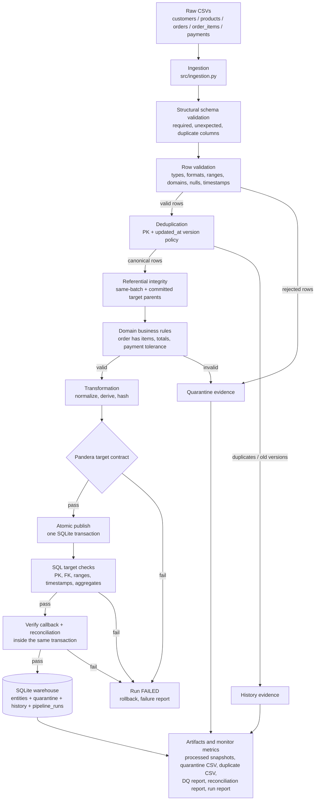
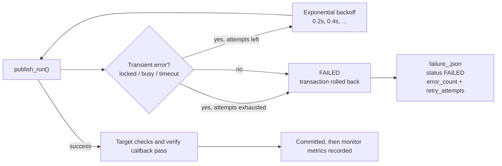

# Architecture

## 1. Design goal

The pipeline is a **single-process, local vertical slice** of a production e-commerce
order analytics system. It intentionally keeps the moving parts small enough to run
and review on a laptop while preserving the properties that matter in production:

- explicit schemas and typed validation;
- deterministic, explainable duplicate handling;
- one atomic publish transaction per run;
- idempotency and safe reruns;
- retry only for transient failures;
- source-to-target reconciliation;
- machine-readable run, data-quality, and reconciliation evidence.

## 2. End-to-end flow



## 3. Module responsibilities

| Module | Responsibility |
|---|---|
| `src/config.py` | Paths, entity list, primary/foreign keys, thresholds, enums, `PipelineSettings`. No secrets. |
| `src/generator.py` | Reproducible curated 79-row dataset and seeded scalable generator (invalid/null/duplicate/late injection). Expected labels are written separately. |
| `src/ingestion.py` | File existence/size checks, raw-header inspection, CSV parsing as text, lineage tagging, file SHA-256 metadata. |
| `src/schemas.py` | Declarative `ColumnSpec`/`EntitySchema` source contracts and Pandera target contracts. |
| `src/validation.py` | Structural validation, per-row validation with multiple reasons, FK checks, order/payment business rules, rejection-frame construction. |
| `src/deduplication.py` | SHA-256 record hashes, vectorized version-aware dedup, conflict detection, naive reference implementation for benchmarking. |
| `src/transformations.py` | Pure normalization: trim, case, ISO-8601 UTC, numeric rounding, derived fields, target column order. |
| `src/publishing.py` | DDL, SQLite pragmas/indexes, safe insert/update, history/quarantine upserts, one transaction per run, target checks, retry classification. |
| `src/reconciliation.py` | Source accounting, SQL target integrity checks, aggregate checks, reconciliation JSON/CSV. |
| `src/reporting.py` | Processed snapshots, quarantine/duplicate evidence CSVs, DQ JSON/CSV/chart, failure report. |
| `src/monitoring.py` | JSON-lines logging, run metrics, status resolution, atomic run-report writes. |
| `src/pipeline.py` | Orchestration, pre-publish accounting, publish/retry, failure handling, artifact wiring. |
| `scripts/` | Data generation, CLI pipeline execution, expected-output verification, direct DB checks, benchmark, evidence export. |
| `tests/` | Unit, integration, data-quality, regression, and required edge-case evidence. |

## 4. Data and transaction boundaries

```text
run_pipeline()
  |-- ingest all entities (read-only)
  |-- validate / deduplicate / apply cross-entity rules (in memory)
  |-- fetch only referenced committed parent keys (chunked IN queries, max 400)
  |-- build rejection + duplicate evidence and prove source accounting
  |-- transform + Pandera target contracts (in memory)
  |-- retry_call(publish_run)
  |     `-- ONE SQLite transaction:
  |           insert/update current rows
  |           archive replaced versions
  |           archive in-batch duplicates
  |           upsert quarantine
  |           run SQL target checks
  |           invoke verify: entity metrics + reconciliation
  |           commit only if every check and the callback pass
  |-- record monitor/run metrics only after commit
  `-- write reports and artifacts
```

The important boundary is the publish transaction: a failure in target checks,
constraints, SQL, or the in-transaction reconciliation callback rolls back
**all entities** from that attempt. There is no partially published entity set.
Retries therefore start from a clean transaction.

Referenced parent keys are read before cross-entity validation so a later batch
can reference a customer/product/order committed by an earlier batch. Only the
keys used by the batch are fetched, not the full target tables. This read never
writes to the target; the final `PRAGMA foreign_key_check` and SQL FK checks
remain the authoritative integrity gate.

## 5. Idempotency model

| Concern | Mechanism |
|---|---|
| Current entity rows | Business primary key + newest `updated_at` wins; identical hash is a no-op (`unchanged`). |
| Quarantine | Deterministic `quarantine_id`; upsert increments `occurrence_count`. |
| History | Deterministic `history_id`; upsert increments `occurrence_count`. |
| Run metrics | `pipeline_runs.run_id` is a primary key, so reusing a run ID replaces that run's metrics rather than duplicating them. |
| Processed files | Per-run snapshot directory plus `latest_<entity>.csv`; reruns do not append. |

## 6. Failure and retry path



The default is 3 attempts with exponential backoff (`src/config.py`). Permanent
errors and reconciliation callback failures are never retried; tests assert both
behaviors. `KeyboardInterrupt` and `SystemExit` are recorded as `FAILED` and then
re-raised rather than swallowed by the generic exception handler.

## 7. Repository layout

```text
data_pipeline_testing/
|-- data/
|   |-- raw/                  # source CSVs only
|   |-- processed/            # per-run accepted snapshots + latest_*.csv
|   |-- rejected/             # quarantine/duplicate evidence CSVs
|   |-- expected/             # tracked expected labels, separate from source input
|   `-- benchmark/            # generated small/10k/100k inputs (gitignored)
|-- docs/
|   |-- data_dictionary.md
|   |-- architecture.md
|   |-- design_decisions.md
|   |-- edge_case_matrix.md
|   |-- testing.md
|   |-- performance.md
|   `-- evidence/             # curated, sanitized submission evidence
|-- reports/                  # run/DQ/reconciliation/benchmark evidence
|-- scripts/
|   |-- generate_data.py
|   |-- run_pipeline.py
|   |-- verify_outputs.py
|   |-- final_db_checks.py
|   |-- benchmark.py
|   `-- export_evidence.py
|-- src/                      # pipeline modules
|-- tests/
|   |-- unit/
|   |-- integration/
|   |-- data_quality/
|   `-- regression/
|-- requirements.txt
|-- requirements-dev.txt      # pinned black/ruff tooling
|-- pyproject.toml            # black/ruff configuration
|-- pytest.ini
`-- README.md
```

## 8. Why no distributed system?

At ~100k rows, pandas + SQLite is fast, deterministic, and easy to inspect. Spark,
Kafka, Airflow, or a cloud warehouse would add operational overhead without
improving the evaluated properties: correctness, validation, tests, idempotency,
recovery, and explainability. The module boundaries are deliberately close to the
interfaces a production orchestrator would call, so a later migration can replace
the storage/execution layer without rewriting validation rules.

## 9. Operational evidence produced per run

| Artifact | Location | Purpose |
|---|---|---|
| Accepted snapshot | `data/processed/<run_id>/<entity>.csv` | Auditable per-run accepted data. |
| Curated evidence | `docs/evidence/` | Sanitized sample output, tests, coverage, benchmark, reconciliation. |
| Latest accepted copy | `data/processed/latest_<entity>.csv` | Convenience for notebooks/BI. |
| Quarantine evidence | `data/rejected/quarantine_<run_id>.csv` | Every rejected row with rules/reasons. |
| Duplicate evidence | `data/rejected/duplicates_<run_id>.csv` | Exact/superseded versions. |
| DQ report | `reports/dq_report_<run_id>.json` / `.csv` / `.png` | Per-entity pass/rejection rates and rule counts. |
| Reconciliation | `reports/reconciliation_<run_id>.json` / `.csv` | Source accounting and target checks. |
| Run report | `reports/run_report_<run_id>.json` | Status, duration, row counters, retry/error counts. |
| Run index | `reports/runs.jsonl` | Append-only machine-readable run history. |
| Pipeline log | `reports/pipeline.log` | JSON-lines operational log. |
| Failure report | `reports/failure_<run_id>.json` | Traceback and context for failed runs. |
